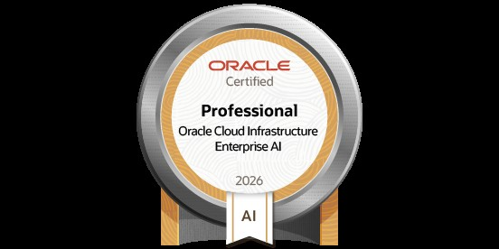
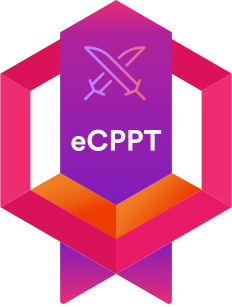
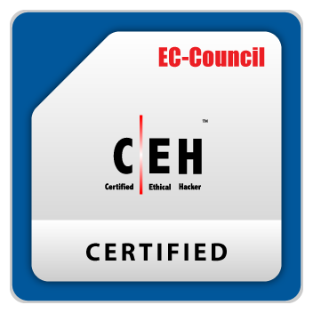
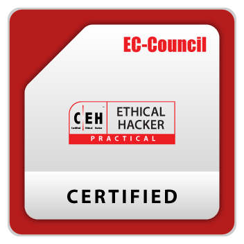
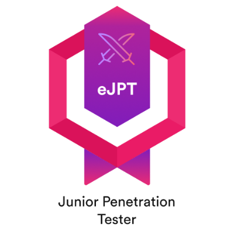
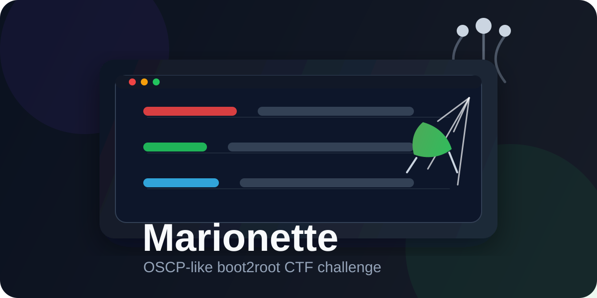

# NONAN23x

**DevOps Engineer @ Winfo Solutions** 
Oracle Certified Professional in Enterprise AI · OCI, secure cloud systems, and intelligent automation.

I build cloud systems for a living, break them to understand where they fail, and automate the work that should never be manual twice.

At **Winfo Solutions**, I work across cloud architecture, SOC operations, and internal AI tools and agents. My current focus is Oracle Cloud Infrastructure and the operational work behind dependable enterprise systems: identity, observability, automation, and security.

I came to OCI with hands-on experience across AWS, Linode, and Hostinger, plus an offensive-security background that still shapes how I engineer. I think in trust boundaries, failure modes, attack paths, and what an operator needs when something breaks at 2 a.m.

## Now

- Working across OCI cloud architecture, SOC operations, and internal AI tooling at an Oracle partner.
- Turning repetitive engineering and security workflows into tools and agents.
- Deepening practical work in IAM, observability, automation, and secure cloud operations.

## What I Build, Break & Teach

- **Building** cloud infrastructure and internal tooling with reliability, operability, and security in mind.
- **Developing** AI agents and repeatable automation for engineering and SOC workflows.
- **Applying** offensive-security experience to trust boundaries, failure modes, attack paths, and defensive design.
- **Designing Marionette**, an OSCP-style boot-to-root VM built around a realistic mapped attack chain.
- **Founding** a **50+ member** college security community, delivering workshops, guest lectures, industry speakers, and **150+ training modules**.
- **Shipping 3+ Unity games** end-to-end, reaching Pro Hacker on HTB (Season 10 Ruby top 20%) and placing in the TryHackMe top 1%.

## Certifications

<table align="center">
  <tr>
    <td width="45%" align="center" valign="middle">
      
    </td>
    <td width="55%" align="left" valign="middle">
      <strong>Oracle Cloud Infrastructure 2026 Certified Enterprise AI Professional</strong>  
      Oracle Cloud Infrastructure Foundations Associate 
      Oracle AI Foundations Associate 
      Oracle Agentic AI Foundations
    </td>
  </tr>
</table>

 

<table align="center">
  <tr>
    <td width="25%" align="center" valign="middle">
      
    </td>
    <td width="25%" align="center" valign="middle">
      
    </td>
    <td width="25%" align="center" valign="middle">
      
    </td>
    <td width="25%" align="center" valign="middle">
      
    </td>
  </tr>
  <tr>
    <td align="center"><strong>eCPPT</strong></td>
    <td align="center"><strong>CEH</strong></td>
    <td align="center"><strong>CEH Practical</strong></td>
    <td align="center"><strong>eJPT</strong></td>
  </tr>
</table>

## Platforms

 
 

 
 

## GitHub Scoreboard

 
 

## Selected Work

<table>
  <tr>
    <td width="50%" valign="top">
      
      <h3><a href="https://github.com/NONAN23x/PKI-CLM-Lab">PKI-CLM-Lab</a></h3>
      
A Public Key Infrastructure and Certificate Lifecycle Management Home Lab walkthrough, featuring EJBCA by Keyfactor

    </td>
    <td width="50%" valign="top">
      
      <h3><a href="https://github.com/NONAN23x/Marionette">Marionette</a></h3>
      
An OSCP-like boot2root CTF challenge

    </td>
  </tr>
  <tr>
    <td width="50%" valign="top">
      
      <h3><a href="https://github.com/NONAN23x/Rootkit-Analysis-Lab">Rootkit-Analysis-Lab</a></h3>
      
Linux rootkit analysis and low-level research lab focused on stealth, persistence, and forensic visibility

    </td>
    <td width="50%" valign="top">
      
      <h3><a href="https://github.com/NONAN23x/SoC-Home-Lab">SoC-Home-Lab</a></h3>
      
Yet another SoC lab

    </td>
  </tr>
</table>

## Notable Contributions

<table align="center">
  <tr>
    <td width="33.33%" valign="top" align="center">
      
      <h3><a href="https://github.com/kubernetes/website/pull/56147">Kubernetes Website · PR #56147</a></h3>
      
Improved navbar-search contrast over light announcement banners in the Kubernetes documentation site — created, reviewed, and merged upstream.

      
    </td>
    <td width="33.33%" valign="top" align="center">
      
      <h3><a href="https://github.com/NONAN23x/fpcmoh-linux">fpcmoh-linux</a></h3>
      
Experimental Linux support, research tooling, and Arch packaging for FPC Disum 10a5:9200 fingerprint sensors.

      
    </td>
    <td width="33.33%" valign="top" align="center">
      
      <h3><a href="https://github.com/jupyterlab/jupyterlab/pull/19066">JupyterLab · PR #19066</a></h3>
      
Created a standalone localization example with a Spanish translation catalog, language switching, interpolation, pluralization, and browser coverage.

      
    </td>
  </tr>
</table>

## Stack

  

  

  

  

## Connect

## Random Quote

